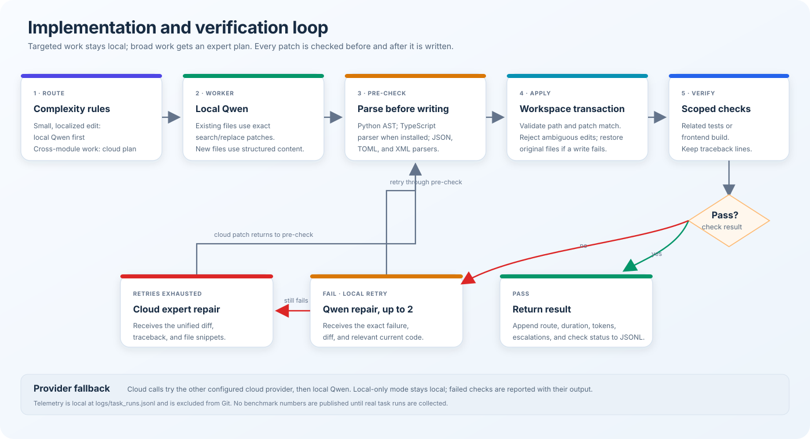
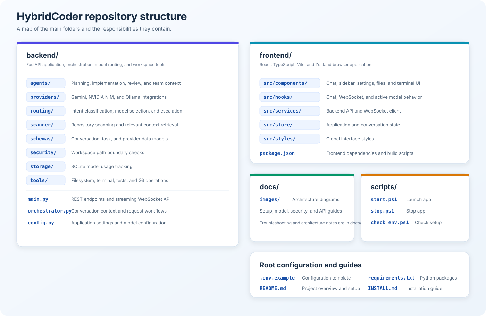

# HybridCoder

HybridCoder is a local-first, multi-model coding assistant for chatting about software and working in a selected project workspace. A React interface connects to a FastAPI backend, which carries conversation context, inspects relevant project files, and routes work to configured cloud and local models.

## What it does

- Provides a streaming chat interface with conversations saved in the browser.
- The stop control cancels the active provider request and terminates child processes launched by workspace commands.
- Routes requests through Gemini, NVIDIA NIM, and local Ollama models, with configurable provider modes and fallbacks.
- Classifies requests and retrieves relevant workspace files when a question or task depends on the selected project.
- Supports engineering workflows that can plan a task, review a plan, implement changes with a local model, and report progress.
- Includes workspace-aware file, repository scanning, terminal, test, and Git tools.
- Tracks model usage in a local SQLite database and reports live model activity in the interface.

## How a request flows

1. The browser sends the new message, selected model mode, conversation history, and active workspace to the backend over WebSocket.
2. The orchestrator classifies the request. For project-related questions and coding tasks, it retrieves relevant files from the selected workspace.
3. The router selects a model or workflow. Depending on the mode and task, the request may use one provider or pass through a planning, review, implementation, or fallback step.
4. The backend streams status, model activity, and the answer back to the browser.
5. When tools are needed, workspace file operations are checked against the configured workspace boundary.

The models are separate services. They do not share hidden state; the orchestrator supplies conversation history, plans, relevant files, and tool results to each model call as needed.

## Model providers

The defaults below come from .env.example. You can change model IDs and provider settings in .env or in the application settings.

| Provider | Default model | Typical role |
|---|---|---|
| Google Gemini | `gemini-3.5-flash-lite` | Full cloud expert for answers, planning, architecture, code review, and intent tie-breaks |
| NVIDIA NIM | `meta/llama-3.3-70b-instruct` | Preferred AUTO/ALL cloud expert for answers and planning when configured; Gemini fallback |
| Ollama | `qwen2.5-coder:7b-instruct-q4_K_M` | Local coding, file edits, and local-first requests |

Gemini and NVIDIA NIM are peer cloud experts with the same general capabilities. AUTO and ALL currently prefer NVIDIA NIM because Gemini is returning temporary high-demand 503 responses. Gemini remains the fallback and can still be selected directly. `NVIDIA+LOCAL` puts NVIDIA first for planning and local Qwen implements; `GEMINI+LOCAL` explicitly keeps Gemini first.

### Routing modes

- `AUTO`: choose a route based on request type; prefer NVIDIA NIM, then Gemini, then local fallback.
- `GEMINI` or `NVIDIA`: prefer the named cloud provider.
- `LOCAL`: use Ollama only.
- `GEMINI+LOCAL` or `NVIDIA+LOCAL`: try the local model first, then the selected cloud provider.
- `ALL`: use the multi-model workflow where applicable.

`GROK` is retained as a legacy configuration alias for NVIDIA; it does not select a separate xAI provider.

## Complexity routing and self-correction

In `AUTO`, localized functions, targeted fixes, and small code changes start on local Qwen. Explicit architectural, multi-file, cross-module, migration, and full-stack requests use a cloud planning step when a cloud provider is configured, then hand implementation to Qwen. If no cloud provider is available, the task stays local.

Existing files are changed with exact search/replace patches. New files use structured content blocks. Before writing, HybridCoder checks patch uniqueness and parses supported formats (Python AST, TypeScript/JavaScript when a parser is installed, JSON, TOML, and XML). A malformed patch is rejected before it touches the workspace; a partial write failure restores the original files.

After edits, the orchestrator runs related tests where it can identify them, or a frontend build for TypeScript changes. A failing check returns its command and traceback to Qwen for up to two bounded repair attempts. If the local attempts still fail, one cloud repair receives the unified diff, exact failure output, and relevant current file snippets. Cloud calls have a provider fallback chain ending in local Qwen; local-only mode stays local. If no matching test or compiler check is configured, telemetry marks the verification as skipped instead of claiming a test passed.

## Run telemetry

Engineering runs append one record to `logs/task_runs.jsonl`. The record includes the task ID, routing decision, retry and escalation counts, duration, reported token counts, changed paths, and baseline/final check status. The log stays local and is ignored by Git.

Summarize the latest 20 recorded runs as a Markdown table:

~~~powershell
python scripts/summarize_runs.py --last 20
~~~

No 15-20 task benchmark has been collected for this repository yet, so this README does not publish synthetic performance numbers. Run the tool after real coding tasks to produce a measured sample.

## Known failure modes

These cases came from development logs or the local setup shown in the application:

| Failure observed | Current handling and remaining limit |
|---|---|
| A retired Gemini model ID returned HTTP 404. | The configured default is `gemini-3.5-flash-lite`. A future model retirement still requires updating the model setting. |
| Gemini Flash-Lite returned HTTP 503 `UNAVAILABLE` with a high-demand message. | This is a provider capacity response; it does not by itself show that HybridCoder sent too many requests. HTTP 429 is the usual quota/rate-limit signal. AUTO and ALL now prefer NVIDIA NIM, with Gemini retained as fallback and as an explicit mode. |
| Gemini and NVIDIA requests timed out. | Provider retries and escalation try another configured provider, then Ollama. If all providers are unavailable, the run reports the error. |
| Ollama returned 404 because the configured Qwen tag was not installed. | A local call failure escalates to a configured cloud provider. Ollama still needs an installed tag matching `OLLAMA_MODEL`. |
| The planner returned numeric `depends_on` values that failed Pydantic validation. | The planner parser now maps numeric order references to generated task IDs and stringifies other references. |
| The development machine reports 6 GB of VRAM. | Scoped context and short repair evidence reduce unnecessary prompt load, but large local models or long context can still run out of memory or become slow. |
| A model can assume the wrong file or change too much. | Existing-file overwrites are blocked in the tool workflow; exact patch matches must be unique, and syntax/tests run around the edit. Tests cannot detect every semantic or unrelated change. |

Checks are only as useful as the repository's available tests and build tools. A skipped check means the code was not behaviorally verified by a test suite.

## Requirements

- Windows 10 or 11
- Python 3.11 or newer
- Node.js 18 or newer, with npm
- Ollama and a compatible model for local inference
- API credentials for the cloud providers you plan to use

Ollama and cloud credentials are optional individually. Configure at least one provider you intend to use.

## Run on Windows

From PowerShell:

~~~powershell
git clone https://github.com/YOUR_USERNAME/HybridCoder.git
cd HybridCoder

py -3.11 -m venv .venv
.\.venv\Scripts\python.exe -m pip install --upgrade pip
.\.venv\Scripts\python.exe -m pip install -r requirements.txt

Copy-Item .env.example .env
notepad .env
~~~

Add the API keys and model settings you want to use to .env. For local inference, install Ollama, start it, and download the configured model. For example:

~~~powershell
ollama pull qwen2.5-coder:7b-instruct-q4_K_M
~~~

Start the application:

~~~powershell
.\scripts\start.ps1
~~~

The startup script launches the FastAPI backend and Vite frontend. By default, the frontend is available at http://localhost:3000, the backend at http://127.0.0.1:8000, and the API documentation at http://127.0.0.1:8000/docs.

Stop the application with:

~~~powershell
.\scripts\stop.ps1
~~~

## Configuration

Copy .env.example to .env and set the values that apply to your setup.

| Variable | Purpose |
|---|---|
| `GEMINI_API_KEY` | Google Gemini API credential |
| `GEMINI_MODEL` | Primary Gemini model ID |
| `NVIDIA_API_KEY` | NVIDIA NIM API credential |
| `NVIDIA_BASE_URL` | NVIDIA-compatible API base URL |
| `NVIDIA_MODEL` | NVIDIA NIM model ID |
| `OLLAMA_BASE_URL` | Ollama server URL, usually `http://localhost:11434` |
| `OLLAMA_MODEL` | Installed Ollama model tag |
| `DEFAULT_MODEL_MODE` | Initial routing mode, such as `AUTO` or `LOCAL` |
| `APP_HOST` / `APP_PORT` | Backend bind address and port |

Keep real credentials in .env; do not commit that file. .gitignore excludes .env, local databases, logs, virtual environments, and generated frontend files.

## Conversations, workspace data, and provider privacy

- Conversation history is persisted in the browser's localStorage, not in a server-side chat database. The frontend sends recent turns with a message so the orchestrator can provide conversational context.
- Usage records are stored locally by the SQLite usage tracker.
- Workspace tools operate relative to the workspace selected in the application. File operations validate resolved paths against that workspace boundary.
- When Gemini or NVIDIA handles a request, the prompt and the context supplied for that call are sent to that provider. Workspace snippets and conversation history may be included when relevant. Review each provider's data policies before sending sensitive material.
- Terminal commands run with the permissions of the local user account. Use care with commands that modify or remove files.

## Project structure

## Development

Install frontend dependencies and run the Vite development server:

~~~powershell
cd frontend
npm install
npm run dev
~~~

Build the frontend:

~~~powershell
npm run build
~~~

From the project root, run the backend test suite with:

~~~powershell
.\.venv\Scripts\python.exe -m pytest backend\tests
~~~

## License

HybridCoder is licensed under the [MIT License](LICENSE). This license applies to project materials owned by the repository copyright holder; third-party dependencies and included assets may have separate licenses.
