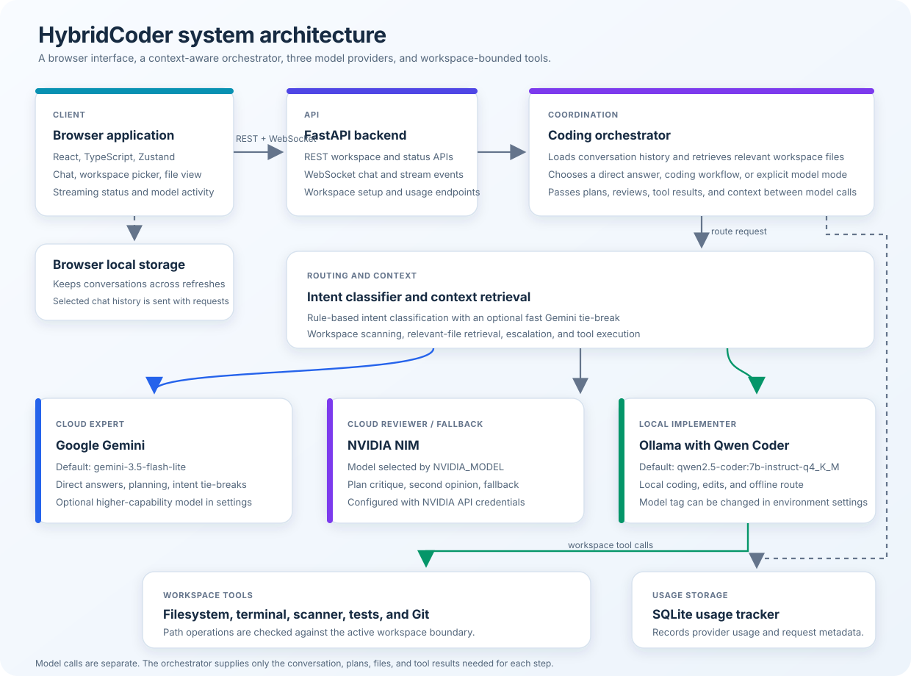

# HybridCoder

HybridCoder is a local-first, multi-model coding assistant for chatting about software and working in a selected project workspace. A React interface connects to a FastAPI backend, which carries conversation context, inspects relevant project files, and routes work to configured cloud and local models.

## What it does

- Provides a streaming chat interface with conversations saved in the browser.
- Routes requests through Gemini, NVIDIA NIM, and local Ollama models, with configurable provider modes and fallbacks.
- Classifies requests and retrieves relevant workspace files when a question or task depends on the selected project.
- Supports engineering workflows that can plan a task, review a plan, implement changes with a local model, and report progress.
- Includes workspace-aware file, repository scanning, terminal, test, and Git tools.
- Tracks model usage in a local SQLite database and reports live model activity in the interface.

## How a request flows

1. The browser sends the new message, selected model mode, conversation history, and active workspace to the backend over WebSocket.
2. The orchestrator classifies the request. For project-related questions and coding tasks, it retrieves relevant files from the selected workspace.
3. The router selects a model or workflow. Depending on the mode and task, the request may use one provider or pass through a planning, review, implementation, or fallback step.
4. The backend streams status, model activity, and the answer back to the browser.
5. When tools are needed, workspace file operations are checked against the configured workspace boundary.

The models are separate services. They do not share hidden state; the orchestrator supplies conversation history, plans, relevant files, and tool results to each model call as needed.

## Model providers

The defaults below come from .env.example. You can change model IDs and provider settings in .env or in the application settings.

| Provider | Default model | Typical role |
|---|---|---|
| Google Gemini | `gemini-3.5-flash-lite` | Direct answers, planning, and intent tie-breaks |
| NVIDIA NIM | `meta/llama-3.3-70b-instruct` | Plan review, second opinion, and cloud fallback |
| Ollama | `qwen2.5-coder:7b-instruct-q4_K_M` | Local coding, file edits, and local-first requests |

In the `ALL` engineering workflow, Gemini plans, NVIDIA reviews the plan, and local Qwen handles implementation. Other modes use the selected provider and configured fallback behavior.

### Routing modes

- `AUTO`: choose a route based on request type and provider availability.
- `GEMINI` or `NVIDIA`: prefer the named cloud provider.
- `LOCAL`: use Ollama only.
- `GEMINI+LOCAL` or `NVIDIA+LOCAL`: try the local model first, then the selected cloud provider.
- `ALL`: use the multi-model workflow where applicable.

`GROK` is retained as a legacy configuration alias for NVIDIA; it does not select a separate xAI provider.

## Requirements

- Windows 10 or 11
- Python 3.11 or newer
- Node.js 18 or newer, with npm
- Ollama and a compatible model for local inference
- API credentials for the cloud providers you plan to use

Ollama and cloud credentials are optional individually. Configure at least one provider you intend to use.

## Run on Windows

From PowerShell:

~~~powershell
git clone https://github.com/YOUR_USERNAME/HybridCoder.git
cd HybridCoder

py -3.11 -m venv .venv
.\.venv\Scripts\python.exe -m pip install --upgrade pip
.\.venv\Scripts\python.exe -m pip install -r requirements.txt

Copy-Item .env.example .env
notepad .env
~~~

Add the API keys and model settings you want to use to .env. For local inference, install Ollama, start it, and download the configured model. For example:

~~~powershell
ollama pull qwen2.5-coder:7b-instruct-q4_K_M
~~~

Start the application:

~~~powershell
.\scripts\start.ps1
~~~

The startup script launches the FastAPI backend and Vite frontend. By default, the frontend is available at http://localhost:3000, the backend at http://127.0.0.1:8000, and the API documentation at http://127.0.0.1:8000/docs.

Stop the application with:

~~~powershell
.\scripts\stop.ps1
~~~

## Configuration

Copy .env.example to .env and set the values that apply to your setup.

| Variable | Purpose |
|---|---|
| `GEMINI_API_KEY` | Google Gemini API credential |
| `GEMINI_MODEL` | Primary Gemini model ID |
| `NVIDIA_API_KEY` | NVIDIA NIM API credential |
| `NVIDIA_BASE_URL` | NVIDIA-compatible API base URL |
| `NVIDIA_MODEL` | NVIDIA NIM model ID |
| `OLLAMA_BASE_URL` | Ollama server URL, usually `http://localhost:11434` |
| `OLLAMA_MODEL` | Installed Ollama model tag |
| `DEFAULT_MODEL_MODE` | Initial routing mode, such as `AUTO` or `LOCAL` |
| `APP_HOST` / `APP_PORT` | Backend bind address and port |

Keep real credentials in .env; do not commit that file. .gitignore excludes .env, local databases, logs, virtual environments, and generated frontend files.

## Conversations, workspace data, and provider privacy

- Conversation history is persisted in the browser's localStorage, not in a server-side chat database. The frontend sends recent turns with a message so the orchestrator can provide conversational context.
- Usage records are stored locally by the SQLite usage tracker.
- Workspace tools operate relative to the workspace selected in the application. File operations validate resolved paths against that workspace boundary.
- When Gemini or NVIDIA handles a request, the prompt and the context supplied for that call are sent to that provider. Workspace snippets and conversation history may be included when relevant. Review each provider's data policies before sending sensitive material.
- Terminal commands run with the permissions of the local user account. Use care with commands that modify or remove files.

## Project structure

~~~text
backend/
  agents/       Planning, local implementation, review, and team context
  providers/    Gemini, NVIDIA NIM, and Ollama integrations
  routing/      Intent classification, model selection, and escalation
  scanner/      Repository scanning and relevant context retrieval
  tools/        Workspace filesystem, terminal, tests, and Git operations
  storage/      SQLite usage tracking
frontend/
  src/          React interface, chat components, hooks, and state
docs/
  images/       System architecture diagram
scripts/        Windows startup, shutdown, and environment scripts
~~~

## Development

Install frontend dependencies and run the Vite development server:

~~~powershell
cd frontend
npm install
npm run dev
~~~

Build the frontend:

~~~powershell
npm run build
~~~

From the project root, run the backend test suite with:

~~~powershell
.\.venv\Scripts\python.exe -m pytest backend\tests
~~~

## License

This repository does not currently include a license file. Add one before redistributing the project or accepting external contributions.
